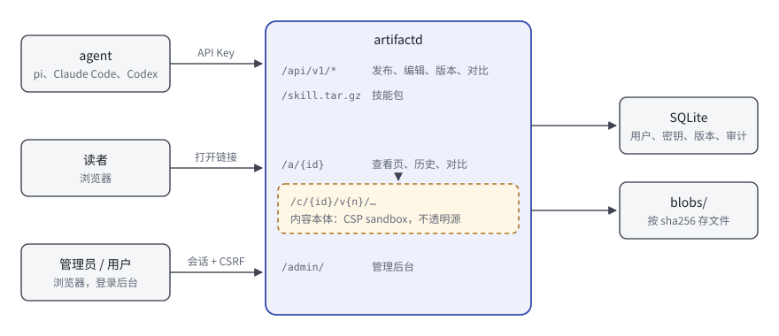

# Artifact 服务

一个自托管的 artifact 发布服务。agent 写好网页、文档、报告或幻灯片后，通过它发布成链接，人在浏览器里打开查看。思路来自 Claude 的 Artifact，但可以给任何 agent 使用：pi、Claude Code、Codex，或者任何能执行命令的 agent。

- 接入只需要一段提示词。服务启动后会生成这段提示词，粘贴给 agent，它会自己下载技能、保存凭据并验证连接。
- 技能里带着写作与设计规范，按渐进式披露组织：agent 只在需要时读对应的参考文档，包括页面运行环境、视觉设计、中文写作规范、文档与幻灯片写法、图表画法和发布前自查。
- 每次修改都生成一个新版本，可以对比任意两个版本的源码和渲染效果，也可以回滚，历史不会被改写。
- 多用户，按密钥鉴权。管理员签发和吊销密钥，为每个用户设置存储、数量和请求频率的限额。
- 管理后台可以查看系统状态与资源占用，检索和浏览所有 artifact，管理用户、密钥和设置，查看审计日志。
- 体积小。单个 Go 程序，数据存在 SQLite 和本地文件里，常驻内存十几 MB，镜像约 30 MB。



## 快速开始（Docker）

```bash
git clone <本仓库> artifact-server && cd artifact-server
cp .env.example .env
# 把 ARTIFACT_PUBLIC_URL 改成你的服务器地址，例如 http://203.0.113.10:8790
vi .env
docker compose up -d --build
docker compose logs artifact
```

首次启动的日志里有三样东西，只显示这一次，请保存好：

1. 管理后台地址和管理员密码（`.env` 里没有设置 `ARTIFACT_ADMIN_PASSWORD` 时随机生成）；
2. 一段给 agent 的接入提示词，里面已经带上了服务地址和一把管理员名下的 API Key；
3. 签发更多密钥的方法。

把第 2 项整段粘贴给 agent 即可。之后对它说“把这份调研整理成一页报告发给我”，它会返回一个 `http://你的地址/a/xxxxxxxxxx` 形式的链接。

### 小内存服务器

镜像默认在容器里编译，编译纯 Go 的 SQLite 需要约 2 GB 内存。内存不足 2 GB 的服务器，在另一台有 Go 1.26 的机器上交叉编译，再用预编译方式构建：

```bash
make linux                       # 生成 bin/artifactd-linux-amd64 和 -arm64
# 把整个目录（含 bin/）传到服务器后：
echo 'ARTIFACT_DOCKERFILE=Dockerfile.prebuilt' >> .env
docker compose up -d --build
```

## 不用 Docker

需要 Go 1.26 或更高版本。

```bash
make build
ARTIFACT_PUBLIC_URL=http://203.0.113.10:8790 ARTIFACT_DATA_DIR=./data ./bin/artifactd serve
```

全部配置都通过环境变量提供，见 [.env.example](.env.example)。

## 接入提示词

日志、管理后台的“密钥”页、命令 `artifactd prompt <用户名>` 都会生成同样的提示词。内容如下（`{服务地址}` 和 `{API Key}` 会被替换成实际值）：

```text
请帮我接入 Artifact 服务。接入后，你可以把网页、文档、报告、幻灯片和数据可视化发布成链接，我在浏览器里打开查看。

服务地址：{服务地址}
API Key：{API Key}
这个 Key 只用于第 3 步，不要写进技能目录或代码仓库，也不要在回复里重复它。

请按顺序完成：

1. 确定你的技能目录：pi 用 ~/.pi/agent/skills，Claude Code 用 ~/.claude/skills，Codex 用 ~/.codex/skills；其他 agent 按自己的文档确定。如果你没有技能机制，就用 ~/.artifact-skill，以后每次需要时先读其中的 SKILL.md。

2. 下载并解压技能，完成后会有 <技能目录>/artifact/SKILL.md：
   mkdir -p <技能目录> && (curl -fsSL {服务地址}/skill.tar.gz || curl -fsSL --noproxy '*' {服务地址}/skill.tar.gz) | tar -xz -C <技能目录>
   第二个 curl 是在代理无法访问该地址时改为直连。

3. 保存凭据并验证（凭据写入 ~/.config/artifact/config.json，权限 600）：
   python3 <技能目录>/artifact/scripts/artifact.py setup --server {服务地址} --key {API Key}
   成功时会输出用户名、配额和用量。

4. 读一遍 <技能目录>/artifact/SKILL.md。以后我请你做网页、文档、报告、幻灯片或图表时，按其中的流程写好、检查、发布，然后把链接发给我。

完成后用一两句话告诉我：技能装在哪里，验证输出了什么。
```

技能更新后，agent 运行 `whoami` 时会看到提示，执行 `self-update` 即可。

## 技能的结构

技能源码在 [skill/artifact/](skill/artifact/)，服务端打包时会填入服务地址和版本号。

```
artifact/
├── SKILL.md                    入口：何时使用、工作流、按任务挑参考文档的路由表、命令速查
├── scripts/artifact.py         命令行工具，只依赖 Python 标准库
├── references/
│   ├── page-contract.md        页面运行环境：沙箱、内置库、主题变量、响应式（写 HTML 前必读）
│   ├── design.md               视觉设计：设计变量、中文排版、模板化痕迹清单
│   ├── writing.md              写作原则：读者、结论先行、具体、诚实、界面文字
│   ├── writing-zh.md           中文规范：排版、标点、数字、病句、AI 腔清单、改写示例
│   ├── documents.md            报告、方案、技术文档、教程的写法
│   ├── slides.md               幻灯片
│   ├── visuals.md              示意图、图表、图片、图标
│   ├── review.md               发布前自查清单
│   └── api.md                  REST API
└── assets/templates/           document.html、deck.html、dashboard.html 三个起步模板
```

agent 平时只读 `SKILL.md`（不到 100 行）。做中文报告时再读 `page-contract.md`、`documents.md`、`writing-zh.md`；做幻灯片时读 `slides.md` 并复制 `deck.html`。

发布时服务端会自动检查，结果随发布响应返回。检查分三级：

| 级别 | 例子 |
|---|---|
| 错误 | 引用了包里不存在的文件；脚本来源不在白名单，会被浏览器拦截；模板示例内容没有替换 |
| 警告 | 中文里用了半角标点；中英文之间缺空格；“赋能”“值得注意的是”“开启新篇章”这类空话套话；加粗和感叹号过多 |
| 建议 | 没有暗色主题；“的”字堆叠；超过 110 字的长句 |

检查只提示，不阻止发布。本地也可以运行 `artifactd check <目录>`。

## 版本与对比

- 每次发布、局部编辑或回滚都生成一个新版本，旧版本只读。
- 文件按内容的 sha256 存储，不同版本、不同 artifact 之间相同的文件只存一份。
- `/a/{id}/history` 列出全部版本；`/a/{id}/diff?from=2&to=5` 并排对比源码，修改过的行会在行内标出具体改动；切换到“页面并排”可以同时看两个版本的渲染效果。
- 回滚是用旧版本的内容生成一个新版本，不会删除中间的历史。
- 发布时带上 `base_version`，如果别处已经更新过，服务端返回 409，避免互相覆盖。
- 设置里可以限制每个 artifact 保留的版本数（默认不限）。

## 可见性

| 可见性 | 谁能看 |
|---|---|
| 私有 | 只有所有者和管理员（需要登录后台） |
| 持链接可看（默认） | 拿到链接的人。链接里的 ID 是 10 位随机字符 |
| 公开 | 拿到链接的人，并显示在首页 |

不论哪种可见性，历史版本、源码和对比页都只对所有者和管理员开放。

## 管理后台

地址是 `/admin/`。管理员能看到：

| 页面 | 内容 |
|---|---|
| 概览 | 运行时长、进程内存与容器上限、CPU、磁盘余量、数据量、近 60 分钟的请求量与延迟、近 14 天的发布量、最近发布、各用户的存储占用；磁盘或内存紧张时顶部给出提醒 |
| Artifact | 全文检索（标题、描述、正文，支持中文），按所有者、可见性、类型筛选；查看预览、版本、文件；修改信息、转移所有者、回滚、删除 |
| 密钥 | 签发（同时生成接入提示词）、吊销、查看最后使用时间和来源 IP |
| 用户 | 新建、停用、单独调整限额、重置密码、删除 |
| 设置 | 默认限额、默认可见性、版本保留数、回收站保留天数、外部资源白名单 |
| 审计日志 | 谁在什么时候对什么做了什么，可按操作和用户筛选 |
| 回收站 | 恢复或彻底删除；清理无引用文件 |

普通用户登录后只能看到自己的 artifact、用量和密钥。

## 运维

### 常用命令

```bash
docker compose exec artifact artifactd user list                 # 列出用户
docker compose exec artifact artifactd user passwd admin         # 重置密码（随机生成）
docker compose exec artifact artifactd prompt alice              # 给 alice 签发新密钥并打印提示词
docker compose exec artifact artifactd gc                        # 立即清理无引用文件
docker compose exec artifact artifactd check /data/some-dir      # 对目录运行发布前检查
```

### 备份

数据全部在 `./data` 目录（`artifact.db` 和 `blobs/`）。可以停机后整个复制，也可以在线备份：

```bash
docker compose exec artifact artifactd backup /data/backup.db
tar czf artifact-backup.tgz data/backup.db data/blobs && rm data/backup.db
```

### 升级

拉取新代码后 `docker compose up -d --build`。数据库迁移在启动时自动执行。

### HTTPS

放在 Caddy 或 nginx 后面，把 `ARTIFACT_PUBLIC_URL` 改成 https 地址，并设置 `ARTIFACT_TRUST_PROXY=true`。详见 [docs/deploy.md](docs/deploy.md)。

## 安全

简要说明，完整内容见 [docs/security.md](docs/security.md)。

- artifact 内容带 `Content-Security-Policy: sandbox`（不含 `allow-same-origin`），运行在不透明源里，读不到后台的登录状态，也调不动管理接口。
- 页面只能从本服务的 `/_lib/` 和白名单 CDN 加载脚本与样式。
- API Key 和会话令牌只存 sha256，密码用 bcrypt；后台写操作校验 CSRF 令牌和请求来源；登录和无效 Key 按 IP 限流。
- 上传的路径会规范化，拒绝 `..`、绝对路径、隐藏文件；文件类型有白名单；磁盘余量低于阈值时拒绝写入。

## 开发

```bash
make test        # 单元测试和接口测试
make build       # 本机构建
make linux       # 交叉编译 linux/amd64 与 linux/arm64
```

目录结构：

```
cmd/artifactd/        主程序与命令行
internal/store/       SQLite 数据访问与迁移
internal/blob/        按 sha256 寻址的文件存储
internal/auth/        密钥、密码、会话、签名链接、限流
internal/artifact/    发布、版本、局部编辑、回滚、对比、HTML 包装、Markdown 渲染
internal/lint/        发布前检查（页面规范与中英文写作规范）
internal/metrics/     进程、容器、磁盘与请求指标
internal/httpapi/     HTTP 接口、查看页、内容服务
internal/skillpack/   技能打包与接入提示词
web/admin/            管理后台（Preact + htm，无需构建）
web/viewer/           查看页、历史、对比、源码页与 Markdown 阅读主题
web/lib/              内置的第三方前端库（固定版本，见 VERSIONS.txt）
skill/artifact/       技能本体
```
